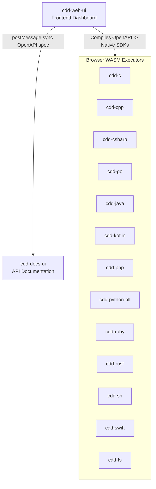
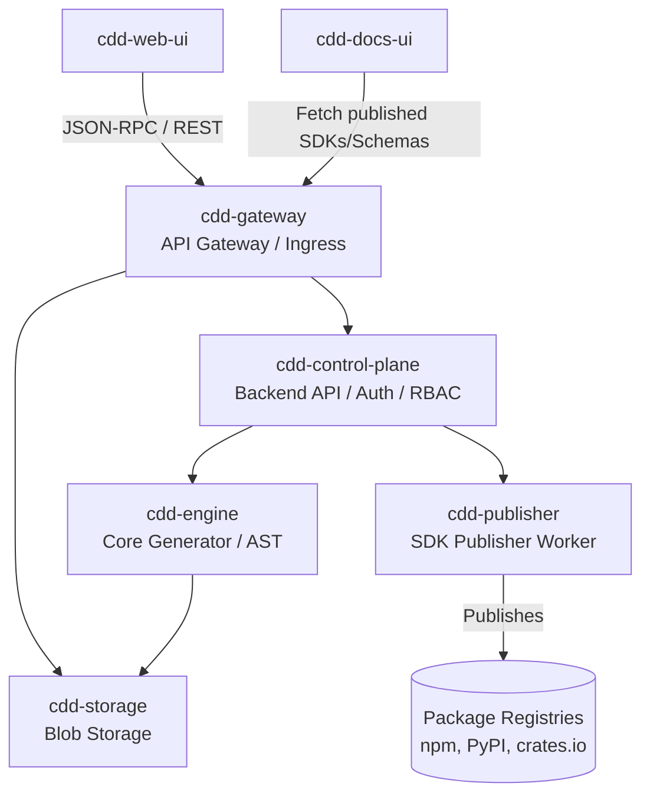

<!-- prettier-ignore -->
cdd-web-ui
==========


[](https://github.com/SamuelMarks/cdd-web-ui/actions/workflows/ci.yml)
[](https://opensource.org/licenses/Apache-2.0)

**CDD Web UI** is the central graphical interface for the Compiler Driven Development (CDD) ecosystem.

Compiler Driven Development is a methodology of rapid application development that focuses on producing _more_ code, not less. Rather than relying on a general-purpose language, DSL, or "generated DO NOT TOUCH" directories, CDD generates idiomatic native code (e.g., Python `class`es, SQL `CREATE TABLE`s, Rust `struct`s) directly into your workspace.

This repository coordinates all known CDD implementations (`cdd-c`, `cdd-rust`, `cdd-ts`, etc.) into a cohesive, offline-first web interface powered by WebAssembly (WASM).

## Features

### Offline-First Architecture

The entire application runs fully offline inside your browser. It utilizes standard browser APIs (`localStorage`) to persist your data locally.

- **Data Model:** Aligns seamlessly with the GitHub API schema (`User` -> `Organization` -> `Repository`) in preparation for future online synchronization and 'Login with GitHub' capabilities.
- **WASM Powered:** Code generation logic is executed natively in the browser via WebAssembly, removing the need for cloud backends or external APIs.
  - **Native WASI Targets:** `cdd-rust`, `cdd-go`, and `cdd-csharp` successfully compile entirely to standalone `wasm32-wasi` and are natively executed inside the browser shim.
  - **C/C++ Emscripten Output:** `cdd-c` and `cdd-cpp` are actively compiled via the `emcmake` toolchain into `JS` wrapping files.
  - **Packaged Virtual Filesystems:** `cdd-ruby` and `cdd-php` pack their entire source-code offline into `wasi-vfs` binaries bundled alongside their pre-compiled interpreters (e.g. VMware Labs PHP or `ruby+stdlib.wasm`).
  - **JVM & Pyodide Mocks:** `cdd-java` and `cdd-kotlin` produce `.jar` files intended to be spun up dynamically via CheerpJ. `cdd-python` produces a `.zip` archive intended to be interpreted using Pyodide's `micropip` infrastructure. `cdd-ts` polyfills deep NodeJS primitives (`node:fs/promises`, `node:crypto`) to run under QuickJS via `javy-cli`.

### Interactive OpenAPI ↔ SDK Editor

- **Bi-directional Editing:** Provide an OpenAPI specification to produce client/server libraries, or edit the generated code and watch it synthesize the OpenAPI spec back.
- **Multi-Language Support:** Toggle code generation for various languages (Python, Rust, TypeScript, etc.). Languages lacking WASM support will display a disabled state.
- **Split-View Pane:** Side-by-side editing interface powered by standard text areas, styled dynamically with Angular Material.

### Technical Stack

- **Framework:** Angular v19+ (Standalone Components, Signals)
- **UI Toolkit:** Angular Material v19+ (`@angular/material`)
- **i18n:** Built-in multilinguality using `@angular/localize`
- **Testing:**
  - Unit tests running on Vitest (100% coverage).
  - End-to-End workflows validated using Playwright (`e2e/`).

## Architecture

### 1. Web Client & Local Execution

The CDD UI can execute code generation entirely offline within the browser via WASM.



### 2. Control Plane & Backend

The UI also interfaces with a backend Control Plane for API routing, cloud generation, and SDK publishing.



## Getting Started

### Local Development

1. **Install dependencies:**

   ```bash
   npm install
   ```

2. **Run the development server:**

   ```bash
   npm start
   ```

   Navigate to `http://localhost:8083/`.

3. **Run tests:**

   ```bash
   npm test
   npx playwright test
   ```

4. **Build and test with local sibling `../cdd-${LANGUAGE}` repositories:**

   Using `make` (or `make.bat` on Windows):

   ```bash
   # Build WASMs from ../cdd-browser-sdk and all ../cdd-${LANGUAGE} directories
   # (cached by git hash & clean non-markdown working tree)
   make build_wasm_local

   # Force rebuild cdd-c even if a cached build is found
   REBUILD_CDD_C=1 make build_wasm_local

   # Force rebuild all WASM binaries and cdd-browser-sdk regardless of cache
   REBUILD_ALL=1 make build_wasm_local

   # Build WASMs locally and build the Angular app
   make build_local

   # Build WASMs locally and serve on http://localhost:8083
   make serve_local

   # Build WASMs locally and run unit tests
   make test_local

   # Build WASMs locally, build the app, and run Playwright E2E tests
   make e2e_local
   ```

### Available `make` Commands

All targets are available via `Makefile` (Unix/macOS) and `make.bat` (Windows):

| Target                         | Description                                                                                                                                                                                                                                         |
| ------------------------------ | --------------------------------------------------------------------------------------------------------------------------------------------------------------------------------------------------------------------------------------------------- |
| `make build_wasm_local`        | Strictly builds `../cdd-docs-ui`, `../cdd-browser-sdk`, and all 13 `../cdd-${LANGUAGE}` WASM binaries locally into `public/assets/wasm/` (never falling back to GitHub releases). Reuses cached local builds if `HEAD` hash is unchanged and clean. |
| `make build_local`             | Runs `build_wasm_local` and builds the Angular application (`npx ng build`).                                                                                                                                                                        |
| `make serve_local`             | Runs `build_wasm_local` and starts the local development server on `http://localhost:8083`.                                                                                                                                                         |
| `make test_local`              | Runs `build_wasm_local` and executes the Vitest unit test suite (`npm test`).                                                                                                                                                                       |
| `make e2e_local`               | Runs `build_wasm_local`, builds the Angular app, and runs Playwright E2E tests (`CI=1 npx playwright test`).                                                                                                                                        |
| `make docs`                    | Generates TypeDoc documentation (`npm run doc`) and links `docs/html` to `documentation`.                                                                                                                                                           |
| `make build_production_docs`   | Runs `npm ci` followed by `npm run build:prod` (gathering WASM binaries strictly from tagged latest GitHub releases).                                                                                                                               |
| `make build_production_c_only` | Runs `npm ci` and builds the C-only configuration with base href `/cdd-web-ui-c-only/` (using tagged latest GitHub releases).                                                                                                                       |
| `make deploy_c_only`           | Runs `build_production_c_only` and deploys the browser output (excluding `assets/wasm`) to `../offscale.github.io/cdd-web-ui-c-only`.                                                                                                               |
| `make build_docker`            | Builds both Alpine (`cdd-web-alpine`) and Debian (`cdd-web-debian`) Docker images.                                                                                                                                                                  |
| `make run_docker`              | Runs the Debian (port `8081`) and Alpine (port `8082`) containers in the background.                                                                                                                                                                |
| `make test_docker`             | Builds, runs, and smoke-tests both Docker containers, extracts `./build-from-debian` and `./build-from-alpine`, and cleans up.                                                                                                                      |
| `make clean_docker`            | Stops and removes the `cdd-web-debian` and `cdd-web-alpine` containers and images.                                                                                                                                                                  |

#### Cache Override Environment Variables (`build_wasm_local` & dependent targets)

- `REBUILD_CDD_C=1`: Forces rebuilding `cdd-c` from `../cdd-c` even if its git hash matches the cached build (e.g., `REBUILD_CDD_C=1 make build_wasm_local` or `make build_wasm_local REBUILD_CDD_C=1`). Any individual target can similarly be forced via `REBUILD_CDD_<LANG>=1` (e.g., `REBUILD_CDD_RUST=1`, `REBUILD_CDD_BROWSER_SDK=1`, `REBUILD_CDD_DOCS_UI=1`).
- `REBUILD_ALL=1`: Forces rebuilding `../cdd-docs-ui`, `../cdd-browser-sdk`, and all `../cdd-${LANGUAGE}` WASM binaries, ignoring all cached `.hash` files (e.g., `REBUILD_ALL=1 make build_wasm_local` or `make build_wasm_local REBUILD_ALL=1`).

### Execution Modes

The CDD Web UI supports four flexible ways to execute code generation, configurable directly from the **Settings Dialog** (gear icon) in the UI:

1. **Locally (relative paths to wasm)**
   - **How it works:** Loads the compiled WASM binaries directly from your local assets folder (`/assets/wasm/`).
   - **Setup:** Run `make serve_local` (or `npm run build:wasm:local` followed by `npx ng serve --port 8083`, with `cdd-${LANGUAGE}` repositories cloned adjacently) or use the pre-packaged assets if available.

2. **Locally (cdd-engine wasm)**
   - **How it works:** Offloads generation entirely to a local `cdd-engine` JSON-RPC daemon running WASM under the hood (via `wasmtime`).
   - **Setup:** Run `cargo run --bin cdd-rpc-wasm --release -- --bind 0.0.0.0:8083 --config ./config.json` from the `cdd-engine` repository. In the UI, set your backend URL to `http://localhost:8083` and switch the mode to "Locally (cdd-engine wasm)".

3. **Locally (cdd-engine native runtimes)**
   - **How it works:** Bypasses WASM entirely and executes native tools installed on your host machine (e.g., Python, Rustc) via the `cdd-engine` daemon.
   - **Setup:** Run `cargo run --bin cdd-rpc --release -- --bind 0.0.0.0:8082 --config ./config.json` from the `cdd-engine` repository. In the UI, set your backend URL to `http://localhost:8082` and switch the mode to "Locally (cdd-engine native runtimes)".

4. **Served (GitHub Releases)**
   - **How it works:** Dynamically fetches the latest pre-compiled WASM binary directly from each respective language's GitHub releases page (e.g. `cdd-python-all`, `cdd-rust`) executing them entirely in your browser.
   - **Setup:** Select "Served (GitHub releases)" from the settings dialog. No local backend or binaries are required.

### Docker Deployment

The application can be compiled into a static artifact and served via an ultra-lightweight Nginx container.

We provide a specialized `make` workflow to clone all requisite `cdd-*` compiler repositories, build the web UI, and package it.

```bash
# Build the Alpine and Debian based images
make build_docker

# Test the resulting containers locally
make test_docker
```

This pipeline automatically extracts the static build output into `build-from-alpine` and `build-from-debian` directories for immediate local hosting or CI/CD artifact storage.

---

## The CDD Ecosystem

This Web UI sits on top of a larger suite of bidirectional compilers:

| Repository                                                     | Language                        | Client; Client CLI; Server | Extra features                                            | Standards                                     | CI Status                                                                                                                                                   | WASM Notes                                               |
| -------------------------------------------------------------- | ------------------------------- | -------------------------- | --------------------------------------------------------- | --------------------------------------------- | ----------------------------------------------------------------------------------------------------------------------------------------------------------- | -------------------------------------------------------- |
| [`cdd-c`](https://github.com/SamuelMarks/cdd-c)                | C (C89)                         | Client; Client CLI; Server | FFI                                                       | Swagger 2.0 & OpenAPI 3.2.0                   | [](https://github.com/SamuelMarks/cdd-c/actions/workflows/ci.yml)             | 1.11MB - Executes via pure WASI                          |
| [`cdd-cpp`](https://github.com/SamuelMarks/cdd-cpp)            | C++                             | Client; Client CLI; Server | Upgrades Swagger & Google Discovery to OpenAPI 3.2.0      | Google Discovery; Swagger 2.0 & OpenAPI 3.2.0 | [](https://github.com/SamuelMarks/cdd-cpp/actions/workflows/ci.yml)         | 4.08MB - Executes via pure WASI                          |
| [`cdd-csharp`](https://github.com/SamuelMarks/cdd-csharp)      | C#                              | Client; Client CLI; Server | CLR                                                       | Swagger 2.0 & OpenAPI 3.2.0                   | [](https://github.com/SamuelMarks/cdd-csharp/actions/workflows/ci.yml)   | 5.71MB - Executes via .NET browser-wasm runtime          |
| [`cdd-go`](https://github.com/SamuelMarks/cdd-go)              | Go                              | Client; Client CLI; Server |                                                           | Swagger 2.0 & OpenAPI 3.2.0                   | [](https://github.com/SamuelMarks/cdd-go/actions/workflows/ci.yml)           | 10.48MB - Executes via pure WASI                         |
| [`cdd-java`](https://github.com/SamuelMarks/cdd-java)          | Java                            | Client; Client CLI; Server |                                                           | Swagger 2.0 & OpenAPI 3.2.0                   | [](https://github.com/SamuelMarks/cdd-java/actions/workflows/ci.yml)       | <0.01MB - Executes via GraalVM WasmGC                    |
| [`cdd-kotlin`](https://github.com/offscale/cdd-kotlin)         | Kotlin (ktor for Multiplatform) | Client; Client CLI; Server | Auto-Admin UI                                             | Swagger 2.0 & OpenAPI 3.2.0                   | [](https://github.com/offscale/cdd-kotlin/actions/workflows/ci.yml)         | 0.66MB - Executes via pure WASI                          |
| [`cdd-php`](https://github.com/SamuelMarks/cdd-php)            | PHP                             | Client; Client CLI; Server |                                                           | Swagger 2.0 & OpenAPI 3.2.0                   | [](https://github.com/SamuelMarks/cdd-php/actions/workflows/ci.yml)         | 6.86MB - Executes via pure WASI                          |
| [`cdd-python-all`](https://github.com/offscale/cdd-python-all) | Python                          | Client; Client CLI; Server |                                                           | Swagger 2.0 & OpenAPI 3.2.0                   | [](https://github.com/offscale/cdd-python-all/actions/workflows/ci.yml) | 0.40MB (+ ~20MB Pyodide & wheels) - Executes via Pyodide |
| [`cdd-ruby`](https://github.com/SamuelMarks/cdd-ruby)          | Ruby                            | Client; Client CLI; Server |                                                           | Swagger 2.0 & OpenAPI 3.2.0                   | [](https://github.com/SamuelMarks/cdd-ruby/actions/workflows/ci.yml)       | 9.37MB - Executes via WASI (rbwasm)                      |
| [`cdd-rust`](https://github.com/offscale/cdd-rust)             | Rust                            | Client; Client CLI; Server |                                                           | Swagger 2.0 & OpenAPI 3.2.0                   | [](https://github.com/SamuelMarks/cdd-rust/actions/workflows/ci.yml)          | 6.87MB - Executes via pure WASI                          |
| [`cdd-sh`](https://github.com/SamuelMarks/cdd-sh)              | Shell (/bin/sh)                 | Client; Client CLI; Server |                                                           | Swagger 2.0 & OpenAPI 3.2.0                   | [](https://github.com/SamuelMarks/cdd-sh/actions/workflows/ci.yml)           | 8.89MB - Executes via pure WASI                          |
| [`cdd-swift`](https://github.com/SamuelMarks/cdd-swift)        | Swift                           | Client; Client CLI; Server |                                                           | Swagger 2.0 & OpenAPI 3.2.0                   | [](https://github.com/SamuelMarks/cdd-swift/actions/workflows/ci.yml)     | 12.26MB - Executes via pure WASI                         |
| [`cdd-ts`](https://github.com/offscale/cdd-ts)                 | TypeScript                      | Client; Client CLI; Server | Auto-Admin UI; Angular; React; Vue; fetch; Axios; Node.js | Swagger 2.0 & OpenAPI 3.2.0                   | [](https://github.com/offscale/cdd-ts/actions/workflows/ci.yml) | 4.08MB - Executes via WASI (QuickJS / Javy)              |

_All 13 of the above implementations successfully compile to WebAssembly and run entirely client-side without any backend server (i.e., CDN-only mode)._

## Platform Architecture

The `cdd` ecosystem is powered by a distributed microservice architecture:

| Repository                                                              | Role        | Description                                                                                        | CI Status                                                                                                                                                               |
| ----------------------------------------------------------------------- | ----------- | -------------------------------------------------------------------------------------------------- | ----------------------------------------------------------------------------------------------------------------------------------------------------------------------- |
| [`cdd-web-ui`](https://github.com/SamuelMarks/cdd-web-ui)               | Frontend    | The central control plane dashboard and UI for managing organizations, repositories, and releases. | [](https://github.com/SamuelMarks/cdd-web-ui/actions/workflows/ci.yml)               |
| [`cdd-control-plane`](https://github.com/SamuelMarks/cdd-control-plane) | Backend API | Manages Database, Auth, RBAC, organizations, and secrets.                                          | [](https://github.com/SamuelMarks/cdd-control-plane/actions/workflows/ci.yml) |
| [`cdd-engine`](https://github.com/SamuelMarks/cdd-engine)               | Generator   | Core code generation, WASI orchestration, and AST transformations.                                 | [](https://github.com/SamuelMarks/cdd-engine/actions/workflows/ci.yml)               |
| [`cdd-gateway`](https://github.com/SamuelMarks/cdd-gateway)             | Ingress     | API Gateway, reverse proxy, and routing.                                                           | [](https://github.com/SamuelMarks/cdd-gateway/actions/workflows/ci.yml)             |
| [`cdd-publisher`](https://github.com/SamuelMarks/cdd-publisher)         | Worker      | Background worker for secure SDK releases to package registries.                                   | [](https://github.com/SamuelMarks/cdd-publisher/actions/workflows/ci.yml)         |
| [`cdd-storage`](https://github.com/SamuelMarks/cdd-storage)             | Storage     | High-performance blob storage for JSON schemas and SDK zip artifacts.                              | [](https://github.com/SamuelMarks/cdd-storage/actions/workflows/ci.yml)             |
| [`cdd-docs-ui`](https://github.com/SamuelMarks/cdd-docs-ui)             | Frontend    | Dynamic API documentation viewer rendered for published endpoints.                                 | [](https://github.com/SamuelMarks/cdd-docs-ui/actions/workflows/ci.yml)             |

---

## License

Licensed under either of

- Apache License, Version 2.0 ([LICENSE-APACHE](LICENSE-APACHE) or <https://www.apache.org/licenses/LICENSE-2.0>)
- MIT license ([LICENSE-MIT](LICENSE-MIT) or <https://opensource.org/licenses/MIT>)

at your option.

### Contribution

Unless you explicitly state otherwise, any contribution intentionally submitted
for inclusion in the work by you, as defined in the Apache-2.0 license, shall be
dual licensed as above, without any additional terms or conditions.
